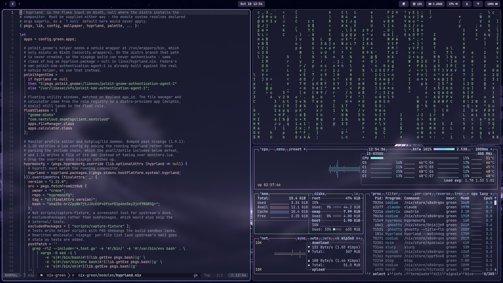
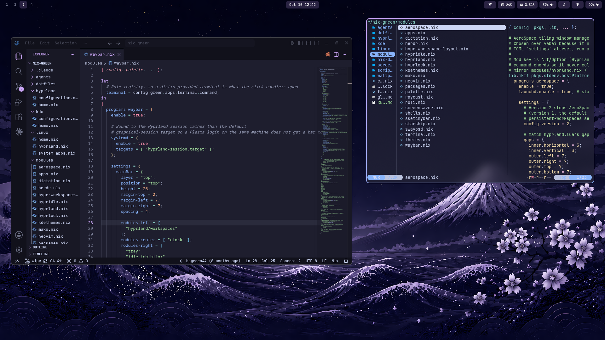

# Description
This is the nix configuration I use for my systems. The main focus of the configuration is that it is simple to use, lightweight and preconfigured with programs that are essential to me. You can choose between [KDE Plasma](https://kde.org/plasma-desktop/) or [Hyprland](https://hypr.land/) on Linux, or run it on macOS through [nix-darwin](https://github.com/LnL7/nix-darwin). This can be installed on most machines due to its low resource usage. Feel free to use this configuration as is or customize it as you see fit!

## In Progress/Future updates
- Gaming support

# Folder Structure
```
nix-green
├── agents
│   └── skills
│       └── nix-green
│           └── SKILL.md
├── configuration.nix
├── dotfiles
├── flake.lock
├── flake.nix
├── global-agents.md
├── hyprland
│   ├── configuration.nix
│   └── home.nix
├── kde
│   ├── configuration.nix
│   └── home.nix
├── linux
│   ├── home.nix
│   ├── hyprland.nix
│   └── system-apps.nix
├── modules
│   ├── aerospace.nix
│   ├── apps.nix
│   ├── dictation.nix
│   ├── herdr.nix
│   ├── hypr-workspace-layout.nix
│   ├── hypridle.nix
│   ├── hyprland.nix
│   ├── hyprlock.nix
│   ├── kdethemes.nix
│   ├── mako.nix
│   ├── neovim.nix
│   ├── packages.nix
│   ├── palette.nix
│   ├── raycast.nix
│   ├── rofi.nix
│   ├── screensaver.nix
│   ├── shells.nix
│   ├── sketchybar.nix
│   ├── starship.nix
│   ├── swayosd.nix
│   ├── terminal.nix
│   ├── themes.nix
│   └── waybar.nix
├── nix-darwin
│   ├── configuration.nix
│   └── home.nix
├── README.md
├── screenshots
├── scripts
│   ├── detect-system-apps.sh
│   ├── install.sh
│   └── uninstall-nix.sh
└── wallpapers
```

# Screenshots




# DISCLAIMER:
**WHILE CHANGES ARE TESTED BEFORE EACH COMMIT, THIS IS AN ONGOING PROJECT THAT CAN POSSIBLY BREAK YOUR SYSTEM. PLEASE INSTALL AT YOUR OWN RISK!**

# How to install
**NOTE: `git` NEEDS TO BE INSTALLED ON YOUR SYSTEM.** 
**THIS CAN BE DONE BY ADDING IT MANUALLY TO `/etc/nixos/configuration.nix` OR TEMPORARILY IN AN INTERACTIVE SHELL BY RUNNING `nix-shell -p git` IN YOUR TERMINAL.**

**FOR MACOS, Nix must come from the [Determinate Nix Installer](https://github.com/DeterminateSystems/nix-installer). The macOS configuration expects it: Determinate manages Nix, so `nix-darwin/configuration.nix` sets `nix.enable = false`. The install script offers to run it for you if Nix is missing.**

This setup works right out of the box, so all you have to do is:
1. Clone the repo to your directory by opening the terminal and running the following command (*if you are using `nix-shell`, make sure to `exit` the shell after running the command*):
```
git clone https://github.com/bsgreen44/nix-green
```
2. Run the install script from the repo
```
cd ~/nix-green
./scripts/install.sh
```
It detects whether you are on NixOS, macOS or another Linux distro, writes your `username` into `flake.nix` (on NixOS and macOS also your `hostname`, and on macOS whether it is Apple Silicon or Intel), installs Nix if it is missing, and runs the matching rebuild command. On Linux it asks which configuration you want: `kde` or `hyprland` on NixOS, `cli` or `hyprland` on other distros. Pass the name to skip the question:
```
./scripts/install.sh hyprland
```
Add `--dry-run` to see what it would change and run without doing it.

3. Rebuild with `rebuild` from then on

The install adds a `rebuild` alias that runs the script with the configuration this machine is on, so you never type or pick the switch command again. Open a new terminal after the first install, then run it from any directory:
```
rebuild
rebuild --dry-run
```
To move to a different configuration, run `./scripts/install.sh <name>` once; `rebuild` follows it after that.

### Manual install
If you'd rather not use the script, follow these steps instead. On macOS or another Linux distro, first install Nix with Determinate:
```
curl --proto '=https' --tlsv1.2 -sSf -L https://install.determinate.systems/nix | sh -s -- install
```

1. Update `hostname` and `username` in `~/nix-green/flake.nix` to match your system
```
    let
      hostname = "nixos"; # change to your hostname
      username = "green"; # change to your username
    in
```
2. While in the `nix-green` directory, rebuild your system using **ONE** of the commands below and you're good to go! 
```
# Make sure you're in the correct directory
cd ~/nix-green

# For KDE desktop
sudo nixos-rebuild switch --flake .#kde --impure

# For Hyprland desktop
sudo nixos-rebuild switch --flake .#hyprland --impure

# For macOS desktop (first install - darwin-rebuild is not installed yet)
sudo nix run nix-darwin/master#darwin-rebuild -- switch --flake .#nix-darwin

# For macOS desktop (every rebuild after that)
sudo darwin-rebuild switch --flake .#nix-darwin
``` 

# How to uninstall
On macOS or another Linux distro, the uninstall script removes nix-green and Nix and returns the machine to a clean state. Run it as your normal user; it asks for `sudo` itself:
```
~/nix-green/scripts/uninstall-nix.sh
```
It asks a few questions up front, then runs without stopping:
- Delete app data: browser profiles, Signal messages, Obsidian/VSCodium settings, AI agent logins and history, Neovim plugins, shell history and the configs nix-green wrote. Your Obsidian vaults and `~/Nextcloud` folder are never deleted.
- Reset the macOS settings nix-green changed (macOS only).
- Remove Homebrew completely (macOS only).
- Delete the `~/nix-green` folder.

What it removes:
- **macOS**: Homebrew casks, Nix apps, nix-darwin, Home Manager, Nix and the Nix Store volume, the Tailscale daemon, SketchyBar, AeroSpace and Nix fonts.
- **Other Linux distros**: Nix apps, Home Manager dotfiles and user services, Nix itself (`/nix`, the `nix-daemon` service and the `nixbld` users) and the swayosd udev rule from [the brightness FAQ](#why-dont-my-brightness-keys-work-on-a-different-linux-distro). Anything you installed with your distro's package manager, such as Hyprland, stays. If you run it from the Hyprland session, log out and pick another session afterwards, since its bar, launcher and config came from Nix.

Files it edits outside your home folder are backed up to `~/nix-uninstall-backup-<date>`, and it lists any `.backup` files Home Manager kept from before nix-green so you can restore them. If it gets interrupted, just run it again. Reboot (macOS) or log out (Linux) at the end.

NixOS is not supported, since Nix is the operating system. Switch to another configuration, or install a different distro instead.

# FAQ Index
**General**

- [Can I use this on a different Linux distro?](#can-i-use-this-on-a-different-linux-distro)
- [Can I run the Hyprland desktop on a different Linux distro?](#can-i-run-the-hyprland-desktop-on-a-different-linux-distro)
- [How do I use apps my distro already installed, instead of the ones Nix declares?](#how-do-i-use-apps-my-distro-already-installed-instead-of-the-ones-nix-declares)
- [Why don't my brightness keys work on a different Linux distro?](#why-dont-my-brightness-keys-work-on-a-different-linux-distro)
- [How do I update the system and packages?](#how-do-i-update-the-system-and-packages)
- [Is there voice dictation?](#is-there-voice-dictation)
- [Where do I put instructions for AI coding agents?](#where-do-i-put-instructions-for-ai-coding-agents)
- [How do I change herdr's keybinds or theme?](#how-do-i-change-herdrs-keybinds-or-theme)
- [Can I play games?](#can-i-play-games)

**Hyprland**

- [Is there a keybind list?](#is-there-a-keybind-list)
- [How do I copy and paste the same way in every app?](#how-do-i-copy-and-paste-the-same-way-in-every-app)
- [How do I change the wallpaper?](#how-do-i-change-the-wallpaper)
- [How do I change the hyprland environment?](#how-do-i-change-the-hyprland-environment)
- [Is there a way to manage hyprland NOT through nix?](#is-there-a-way-to-manage-hyprland-not-through-nix)
- [How do I change the scaling and resolution?](#how-do-i-change-the-scaling-and-resolution)
- [How do I change the screensaver?](#how-do-i-change-the-screensaver)
- [How do I toggle a workspace's layout?](#how-do-i-toggle-a-workspaces-layout)

# FAQ

### Can I use this on a different Linux distro?
Yes (mostly)! The `~/nix-green/modules` directory contains all of the Home Manager setup including packages, dotfiles and user preferences. What won't transfer over are system level settings and services specific to NixOS set in `configuration.nix` such as boot loader, kernel, openssh and tailscale. These are set on your Linux distro.

To install on any Linux distro, clone the repo and run the install script, choosing `cli`. It installs Nix if needed and runs Home Manager:
```
git clone https://github.com/bsgreen44/nix-green
cd ~/nix-green
./scripts/install.sh cli
```

To do it by hand instead, install Nix with Determinate (see [How to install](#how-to-install)), set `username` in `flake.nix`, and run:
```
nix run home-manager/master -- switch -b backup --flake .#username
```

For future updates, use `./scripts/install.sh cli` or:
```
home-manager switch --flake .#username
```

### Can I run the Hyprland desktop on a different Linux distro?
Yes. There are two Home Manager configurations: `.#username` installs CLI tools and dotfiles only, and `.#username-hyprland` adds the Hyprland desktop on top of it. Nix writes the config, your distro supplies the compositor.

1. Install `hyprland`, `xdg-desktop-portal-hyprland` and `hyprlock` with your distro's package manager. Some distros ship these in a third-party repository rather than the default ones.
2. Switch to the desktop configuration
```
./scripts/install.sh hyprland
```
Or do it by hand with `home-manager switch -b backup --flake .#username-hyprland`.
3. On a laptop, allow swayosd to control screen brightness (see the FAQ entry below). Volume works without this.
4. Log out and pick Hyprland from your login screen's session list.

Distro-specific settings, such as the wallpaper path, live in `~/nix-green/linux/hyprland.nix`.

### How do I use apps my distro already installed, instead of the ones Nix declares?
`modules/apps.nix` defines a role registry - `terminal`, `fileManager`, `calculator`, `imageViewer`, `archiver`, `pdfViewer`, `office`. Each role names the command to run, its Wayland `app_id` (for the floating window rules), its `.desktop` file (for default-application handling) and the package Nix installs for it. Setting a role's `package = null` means "the distro provides this binary, install nothing".

The defaults are the nixpkgs apps, and every override for your machine goes in one file, `linux/system-apps.nix`. To find out what your distro already has:
```
./scripts/detect-system-apps.sh
```
It scans `/usr/bin` (never `$PATH`, which would match Nix's own packages), reports the owning distro package, and prints a `green.apps` block to paste into `linux/system-apps.nix`. Moving to another distro means rewriting that one file, or emptying it to `green.apps = { };` to have Nix install everything again.

The scan is a script rather than something the config does during evaluation, because a flake evaluates in pure mode: `builtins.pathExists "/usr/bin/dolphin"` returns `false` there even when the file exists, and with `eval-cache` on, an `--impure` answer can go stale. Declaring the result keeps the config reproducible.

Two things the registry does not cover. There is no browser role, so the `browser` local at the top of `modules/hyprland.nix` names it literally - edit that local by hand. And `app_id` values the script reads from a `.desktop` name are a guess; confirm them with `hyprctl clients -j | jq -r '.[].class'` with the app open, or its window will not float.

### Why don't my brightness keys work on a different Linux distro?
Nix installs swayosd and runs it as a user service, but it can't set the permissions swayosd needs to change brightness. That part is a system-level change, so it has to be done once, by hand, as root. On NixOS `hyprland/configuration.nix` already handles it.

The kernel exposes brightness at `/sys/class/backlight/*/brightness`, owned by `root` and read-only for everyone else. swayosd runs as your user and writes that file directly, so it needs write access. Backlight devices have no `/dev` node, which is why udev's usual `GROUP=`/`MODE=` settings don't apply here and the rule has to call `chgrp`/`chmod` itself.

1. Give the `video` group write access to brightness
```
sudo tee /etc/udev/rules.d/99-swayosd.rules > /dev/null <<'EOF'
ACTION=="add", SUBSYSTEM=="backlight", RUN+="/usr/bin/chgrp video /sys/class/backlight/%k/brightness"
ACTION=="add", SUBSYSTEM=="backlight", RUN+="/usr/bin/chmod g+w /sys/class/backlight/%k/brightness"
EOF
```
2. Add yourself to the `video` group
```
sudo usermod -aG video $USER
```
3. Apply the rule without rebooting
```
sudo udevadm control --reload
sudo udevadm trigger --action=add --subsystem-match=backlight
```
4. Log out and back in, so your graphical session (and the swayosd service in it) picks up the new group.

Check it worked. The file should be group `video` and group-writable (`rw-rw-r--`), and `video` should appear in your groups:
```
ls -l /sys/class/backlight/*/brightness
id -nG
```

Installing swayosd from your distro's package manager instead is not a substitute: it would still not add you to the `video` group, it duplicates the copy Nix already installs, and not every distro packages it (Fedora does not).

### How do I update the system and packages?
In the `~/nix-green` directory, run `nix flake update`. This will update `flake.lock`. Then run `rebuild`, or `sudo nixos-rebuild switch --flake .#changethis --impure`, replacing `changethis` with `kde` or `hyprland`.

On other distros, run `nix flake update` followed by `rebuild`, or `home-manager switch --flake .#username`, or `.#username-hyprland` if you installed the desktop.

### Is there voice dictation?
Yes, the `dictation` command, installed on every Linux configuration (`modules/dictation.nix`). Run it once to start recording and again to stop. The audio is transcribed on your machine by [whisper.cpp](https://github.com/ggml-org/whisper.cpp), so nothing is sent anywhere. The text is copied to the clipboard, and on Hyprland it is also typed into the focused window.

On Hyprland it is bound to `SUPER + D`. On KDE Plasma, GNOME and other desktops, add a custom shortcut that runs `dictation` in the desktop's keyboard settings. Those desktops do not allow other programs to type into windows, so paste the text with `Ctrl + V`.

### Where do I put instructions for AI coding agents?

`global-agents.md` in the repo root. It is the single source of truth, and `modules/packages.nix` links it into every harness's global instruction path:

| Harness | Path |
| --- | --- |
| Claude Code | `~/.claude/CLAUDE.md` |
| Codex CLI | `~/.codex/AGENTS.md` |
| opencode | `~/.config/opencode/AGENTS.md` |

All three are `mkOutOfStoreSymlink` links, which point at the working tree rather than the Nix store. Edit `global-agents.md` and every agent picks the change up on its next run - no `home-manager switch`, no `nixos-rebuild`. The cost is that the content is not reproducible from the flake alone; it is whatever the checkout holds. That is deliberate, because a read-only store symlink would stop the agents (and you) from appending to their own instructions.

The path is hardcoded to `~/nix-green`. A checkout anywhere else needs `agentsContext` in `modules/packages.nix` edited.

**Why it is not called `AGENTS.md`.** All three harnesses walk up from the current directory looking for a project `AGENTS.md`. Naming the file that would make it double as *this repo's* project instructions, so working inside `nix-green` would load the same content twice - once globally, once as project context. opencode keys its instruction set on `path.resolve`, which does not follow symlinks, so it cannot tell the two apart; neither it nor Codex has a way to opt out. The `global-agents.md` name is discovered by nothing, so it stays purely global. Project instructions, if this repo ever wants them, belong in a separate `AGENTS.md` or `CLAUDE.md`.

### How do I change herdr's keybinds or theme?
Edit `modules/herdr.nix`, then run `rebuild`. [herdr](https://github.com/ogulcancelik/herdr) (the AI coding-agent multiplexer) has no Home Manager module, so the file generates `~/.config/herdr/config.toml` with `pkgs.formats.toml`. It is imported on every configuration: Hyprland, KDE, other Linux distros and macOS.

The keybinds are tmux-style with `Ctrl + Space` as the prefix: a tmux session is a herdr workspace, a window is a tab and a pane is a pane. Press `Ctrl + Space` then `?` inside herdr to see them all.

Only the config file is linked, not the directory, because herdr keeps `session.json`, sockets and logs next to it. `onboarding = false` is declared so herdr never needs to write to the read-only file.

### Can I play games?
Yes, on NixOS and macOS. Gaming is off by default so low-end machines stay lean. On a gaming machine, set `gaming = true;` in `flake.nix` and run `rebuild`.

On NixOS this turns on `modules/gaming.nix`: Steam with Proton and [GE-Proton](https://github.com/GloriousEggroll/proton-ge-custom), gamescope, GameMode, protontricks, [Lutris](https://lutris.net) and MangoHud. Steam also adds a "Steam Big Picture" session to the login screen.

- **Steam games (e.g. Cyberpunk 2077):** in Steam, open Settings > Compatibility and enable Steam Play for all titles. Pick GE-Proton per game under Properties > Compatibility if Valve's Proton gives trouble. Add `gamemoderun mangohud %command%` to a game's launch options for GameMode and the FPS overlay.
- **Battle.net games:** in Lutris, search for Battle.net and run its installer, then install your games from Battle.net. Alternatively, add the Battle.net installer to Steam as a non-Steam game and force GE-Proton.

With `gaming = true;`, Hyprland uses focused-window rules to inhibit automatic dimming, screensaver, locking, display shutdown and idle suspend for games matched in `modules/hyprland.nix`, in windowed or fullscreen mode. Switching away or closing the game releases this inhibitor; manual locking still works. Coverage depends on the game's window class; the rule does not cover every Battle.net game or the Battle.net and Lutris launchers. GameMode's process-wide screensaver inhibition is disabled on Hyprland so it does not keep background games awake; other applications or the Waybar idle toggle can still inhibit idle independently. To inspect a game's window class, run `hyprctl clients -j`.

The NVIDIA driver (`modules/nvidia.nix`) is separate from `gaming`: `install.sh` detects the GPU and writes `gpu = "nvidia";` (or `amd`, `intel`, `none`) to `flake.nix`, so every NixOS machine with an NVIDIA card gets the proprietary driver. It uses the open kernel module, which needs an RTX 20xx / GTX 16xx or newer. Hybrid laptops also need `hardware.nvidia.prime` set up by hand. AMD and Intel work out of the box.

On macOS, `gaming = true;` installs the Steam and Battle.net casks. Game availability and hardware requirements depend on each game's macOS support.

## Hyprland

### Is there a keybind list?
`SUPER + SHIFT + H` opens a searchable keybind list. Edit the keybinds in `hyprland.nix`, and the descriptions in `rofi.nix`. App names that come from the role registry (terminal, file manager) are interpolated into both, so those stay in sync on their own. See [hyprland wiki](https://wiki.hypr.land/Configuring/Binds/) on how to set binds.

### How do I copy and paste the same way in every app?
Use `SUPER + C` to copy, `SUPER + V` to paste and `SUPER + X` to cut. They send `Ctrl + Insert`, `Shift + Insert` and `Ctrl + X` to the focused window, which terminals and GUI apps both understand, so one set of keys works everywhere. Ghostty and kitty normally paste the primary selection on `Shift + Insert`, so both are set to paste the clipboard instead. `SUPER + CTRL + V` opens the clipboard history.

The binds are in `hyprland.nix` and their descriptions in `rofi.nix`.

### How do I change the wallpaper?
Set `wallpaper` in the `_module.args` block to the path of the desired wallpaper. On NixOS this is in `~/nix-green/hyprland/home.nix`; on other distros it's `~/nix-green/linux/hyprland.nix`.
```
  _module.args = {
    wallpaper = "/home/${username}/nix-green/wallpapers/linux-catppuccin.jpg";
  };
```
Rebuilding is enough when the path changes: swaybg runs as the `swaybg` user service, and `home-manager switch` restarts it. Only editing an image in place under the same filename needs a manual restart:
```
systemctl --user restart swaybg
```
If your wallpaper is not in `~/nix-green/wallpapers/` make sure to update this to the desired path. The wallpaper doubles as the hyprlock background. `-m fill` crops to cover, so size the image for your widest monitor.

### How do I change the hyprland environment?
hyprland    ----> `hyprland.nix` `hyprlock.nix` `hypridle.nix`

waybar      ----> `waybar.nix`

rofi (menu) ----> `rofi.nix`

After making changes, run `rebuild` (or `sudo nixos-rebuild switch --flake .#hyprland --impure`, or `home-manager switch --flake .#username-hyprland` on other distros).
*NOTE: hyprland is managed by home manager. DO NOT modify files in `~/.config`. Any changes to the files will be overwritten after rebuild.*

### Is there a way to manage hyprland NOT through nix?
For quick, machine-local tweaks that you don't want tracked in the flake, uncomment the `source` line in the monitor section of `hyprland.nix` and create the file:
```
# source = ~/.config/hypr/local.conf
```
Hyprland sources that file (monitor layout, keybinds, etc.) if it exists, and treats a missing file as a harmless no-op. Edit it and run `hyprctl reload` to apply without a rebuild. Note this is mutable, untracked state that lives outside the flake, so it is not reproducible across machines.

### How do I change the scaling and resolution?

Use `hyprmoncfg`. Run `hyprmoncfg` (or open it from the launcher), arrange the displays, set each one's mode and scale, and press `s` to save the layout as a named profile, e.g. `docked` or `laptop`. The `hyprmoncfgd` user service then applies the best matching profile whenever monitors are plugged or unplugged or the lid changes. Profiles live in `~/.config/hyprmoncfg/profiles/` and persist across reboots and rebuilds.

Displays no profile covers fall back to their preferred mode at scale 1.

### How do I change the screensaver?
Edit `screensaver.nix` to change the screensaver text/ASCII art.

To turn the screensaver off, flip the `green.screensaver.enable` option - `~/nix-green/hyprland/home.nix` on NixOS, `~/nix-green/linux/hyprland.nix` on other distros:
```
green.screensaver.enable = false;
```
When `true`, hypridle's 3-minute idle timeout runs `screensaver --lock`, and the screensaver locks the session itself after a further 2 minutes. When `false`, that timeout runs `loginctl lock-session` directly. The 2.5-minute dim, 5.5-minute display-off and 20-minute suspend listeners are the same either way, and `SUPER + SHIFT + Z` still launches the screensaver by hand in both cases.

Flip the flag and run `rebuild` (or `sudo nixos-rebuild switch --flake .#hyprland --impure`, or `home-manager switch --flake .#username-hyprland` on other distros).

### How do I toggle a workspace's layout?
`SUPER + SHIFT + L` flips the active workspace between `dwindle` and `scrolling`. It's per-workspace - other workspaces keep whatever they were last set to - and persists across `hyprctl reload` and reboot, unlike the general `layout` setting in `hyprland.nix`, which only picks the default a workspace starts from.

The toggle writes the override to `~/.local/state/nix-green/workspace-layouts`, and `hypr-workspace-layout.nix` replays it into a `hl.workspace_rule(...)` call on every config load. Note this is mutable, untracked state that lives outside the flake, so it is not reproducible across machines. Deleting that file and running `hyprctl reload` resets every workspace back to the layout declared in Nix.
